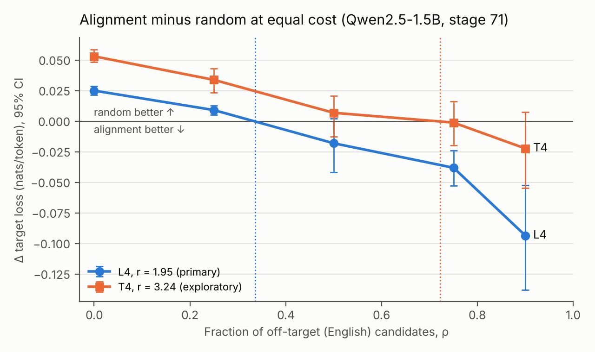
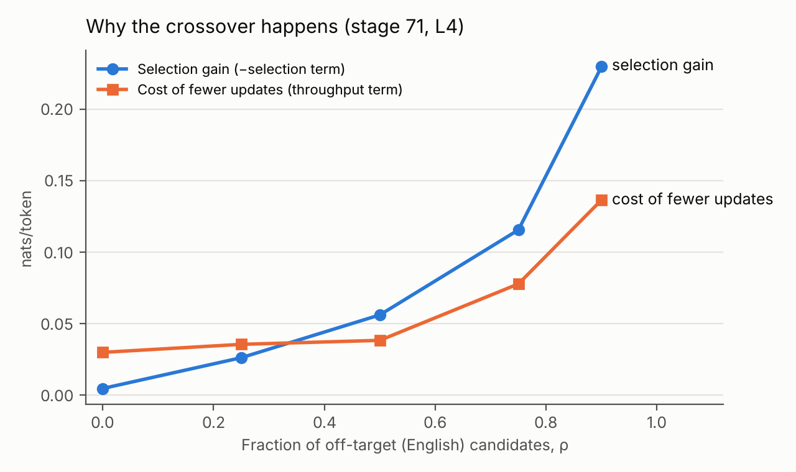

# When Does Data Selection Pay for Itself? Cost-Charged Evaluation of Online Selection for Language-Model Adaptation

Working draft, 25 November 2026. Numbers come from committed results in this repository; each claim names its source file. Audit status is stated per stage (Section 7). Literature statements marked [snippet] were checked only against search-result summaries and must be verified against the papers before submission.

## Abstract (provisional)

Online data selection chooses, at each step, which examples a model learns from. It is usually compared with random training at equal numbers of updates, which hides the cost of the decision. We charge each policy its measured step cost and decompose every cost-matched comparison exactly into a selection term (value per update) and a throughput term (updates forgone). Across pre-registered experiments on Arabic and English text, from a 35,776-parameter byte-level Transformer trained from scratch to LoRA adaptation of Qwen2.5-0.5B and 1.5B on GPUs, three results recur. (1) On models trained from scratch, gradient-alignment selection improves loss per update by only 0.4–2% of random training's gain but costs 6–11 random steps, and loses in every seed. (2) Per-update value is not stationary: a pre-registered forecast of cost-matched winners from equal-update measurements failed (6/10 correct), because rules such as highest-loss selection change what they pick as training proceeds. (3) On pretrained LLMs, computing per-example LoRA gradients from one batched backward pass lowers the cost of alignment to 1.3–2.1 random steps on a GPU, and alignment then wins exactly when much of the candidate pool is unsuitable for the target: with 90% off-language candidates it beat random in every seed for both model sizes (e.g. Qwen2.5-1.5B on Arabic Wikipedia, −0.090 nats/token, 95% CI [−0.109, −0.073]), whereas with in-domain candidates random won (+0.027 [+0.022, +0.033]). Highest-loss selection, despite being cheap, chose off-target data and was the worst policy whenever contamination was present. The value of a selection rule is therefore a property of the candidate pool and the cost ratio together, and should be reported as such. A final offline test on real Arabic web text (FineWeb-2, half of it documents removed by quality filters) toward a downstream task (ArabicMMLU) found no benefit: scoring the pool once cost 40% of the budget, every policy raised the task loss, and the filter lost to random at equal cost (+0.070 [+0.006, +0.131]), so the contamination rule applies only when part of the pool actually helps the target. A follow-up that mixed in-format question–answer items into the web pool showed that this condition is not sufficient for offline filtering: the filter found the useful items (93% of its kept set against 25% of the pool) and beat a random subset of the same size and repetition in every seed, but repeating a quarter of the pool cost more than the selection gained, and random still won at equal cost (+0.063 [+0.035, +0.091]). Keeping enough of the pool to see each kept chunk only once removed that loss (−0.183 against the quarter filter) but diluted the useful share, and the equal-cost gain over random was not established (−0.033 [−0.086, +0.019]). On a four-times larger pool with enough useful chunks to fill the budget, a cheaper proxy scorer (Qwen2.5-0.5B) kept 99% useful chunks and the one-pass filter beat random at equal cost in every seed (−0.198 [−0.250, −0.138]) although scoring took 46% of the budget, close to a label oracle (+0.008 [−0.038, +0.040]).

## 1 Introduction

The question is not whether a selection rule picks better examples, but whether it picks examples better by more than it costs to pick them, and in which data regimes. Three observations motivate this paper:

1. In this project, every gradient-guided policy lost to uniform random selection under equal wall-clock budgets on small from-scratch models (stages 35, 37, 58, 60, 64, 65), despite small gains at equal update counts (stage 58; stage 64 decomposition).
2. The gap is not noise: the decomposition attributes nearly all of it to throughput (Arabic reuse4, stage 64: selection −0.0123, throughput +0.4923).
3. Recent online selection methods address exactly this cost. GREATS (Wang et al., NeurIPS 2024) computes per-example gradient inner products from activations and output gradients already available in backpropagation ("ghost inner products"), and reports runtime comparable to regular training [snippet]. A later paper reports that the method was memory-intensive and unstable beyond GPT-2 124M in its setting (ESLM, arXiv 2505.19893) [snippet]. Compute-positive selection has also been studied in FLOPs rather than wall-clock (arXiv 2312.05328) [snippet].

Contributions:
- An exact replay decomposition of cost-matched comparisons into selection and throughput terms, with a first-order break-even condition, applicable to any online selection method.
- Evidence that equal-update comparisons at a shared update count can mislead in either direction, because per-update selection value changes over training (pre-registered falsification, stage 67).
- A regime map for LoRA adaptation of pretrained LLMs: cost-charged gradient alignment wins under off-target contamination and loses on in-domain pools, replicated across two model sizes and three stages (68–70).
- Evidence that cheap loss-based rules can have negative per-update value and pick off-target data under contamination.
- Pre-registered protocols committed before outcomes, append-only run journals and audits; Arabic as the primary language throughout.

## 2 The break-even condition

Let L_R(n) be target loss after n random updates and L_G(n) after n guided updates, both from the same state. Within a budget T, random completes N_R updates and the guided rule N_G = N_R / r. Then exactly

L_G(N_G) − L_R(N_R) = [L_G(N_G) − L_R(N_G)] + [L_R(N_G) − L_R(N_R)].

The first bracket (selection term, −s) is measured by replaying the first N_G steps of the random schedule. The second (throughput term) is the loss forgone by fewer updates. If L_R decreases approximately linearly over [N_G, N_R], with a = L_R(0) − L_R(N_G), the throughput term is ≈ (r − 1) a, so the guided rule wins only if s/a > r − 1. Curvature of real learning curves can move the throughput term either way: concavity makes it smaller than (r − 1)a, while a random curve that is flat early and steep later (stage 67, high contamination) makes it larger. This is why the decomposition is measured by replay rather than assumed, and why a single-point estimate of s/a is not a forecast.

## 3 Experimental protocol

Common setting (stages 58–65): ByteTransformer, 35,776 parameters, 256-byte vocabulary, 64-byte context; AdamW (lr 1e-3, wd 0.01); one 65-byte chunk per update; single CPU thread; deterministic Torch. Candidates from official train splits of UD r2.15 Arabic-PADT and English-EWT; probe from dev; target 256 test chunks (stage 64) or 512 previously unscored dev chunks (stage 65). The deadline loop accepts only updates completed within 3 s and charges indexing, cloning, scoring and probe refreshes to each policy. Protocols: `research/ud-reuse-timed-protocol.json`, `research/ud-cost-frontier-protocol.json`.

## 4 Results

### 4.1 Equal-time comparison (stage 64; `results/ud-reuse-timed.json`)

| Arabic | final loss | updates |
| --- | --- | --- |
| alignment, gradient reused 4 steps | 2.19866 | 66.8 |
| alignment, fresh gradient | 2.55321 | 37.9 |
| random | 1.71865 | 412.7 |

Reusing the probe gradient beat fresh alignment in all eight seeds (−0.35455), and random beat both in all seeds.

### 4.2 Varying decision cost (stage 65; `results/ud-cost-frontier.json`)

| Arabic arm | r | s/a | selection term | throughput term | timed loss − random [95% CI] |
| --- | --- | --- | --- | --- | --- |
| highest loss of 4 | 1.22 | −0.0002 | +0.0003 | +0.0133 | +0.0136 [0.0091, 0.0181] |
| highest loss of 16 | 1.56 | −0.0145 | +0.0260 | +0.0378 | +0.0638 [0.0563, 0.0721] |
| highest loss of 64 | 2.84 | −0.0365 | +0.0625 | +0.1281 | +0.1907 [0.1829, 0.1986] |
| alignment, reuse 4 | 6.03 | +0.0044 | −0.0064 | +0.3915 | +0.3850 [0.3658, 0.4082] |

English shows the same ordering with larger harm from highest-loss selection (loss64 selection term +0.4402). The inequality agreed with all 80 state-level outcomes, but none was near the boundary.

### 4.3 Pretrained LLM (stage 66; `results/llm-selection.json`)

Qwen2.5-0.5B, LoRA rank 8 on q/v (540,672 trainable parameters), 64 matched updates, four seeds per language.

| arm | Arabic loss@64 − random | s/a | r | break-even r − 1 |
| --- | --- | --- | --- | --- |
| highest loss of 4 | +0.0034 | −0.073 | 2.12 | 1.12 |
| gradient-dot of 4 | −0.0162 (4/4 seeds) | 0.346 | 4.17 | 3.17 |

English: gradient-dot −0.0232 (4/4), s/a 0.172, r 4.28. Relative to the from-scratch byte model, the alignment gain per update is about 80 times larger, and the gap to break-even narrows from about 1,100× to about 9×. Several factors changed together (pretraining, scale, LoRA, token units, dot-product scoring), so the increase is not attributed to one of them. Replay audit pending.

### 4.4 Can equal-update measurements forecast equal-time outcomes? (stage 67; `results/mixture-crossover-phaseB.json`)

Candidate pools mixed Arabic with a fraction ρ ∈ {0, .5, .8, .9, .95} of English; the target was Arabic. Phase A (64 equal updates, 4 seeds) produced committed predictions; phase B (8 new seeds, 3 s budget, 360 runs) tested them. The pre-registered rule s/a > r − 1 was correct in 6/10 cases, with 4 contradictions whose 95% intervals exclude zero, so it fails its pre-specified criterion. Phase A also exposed a sign error in the ratio form when a < 0 (ρ = .95); the undivided form s > (r − 1)a, added in an addendum before phase B, also scored 6/10.

The failure has a clear mechanism: selection value is nonstationary. Highest-loss selection preferred Arabic during the first 64 updates (English share 0.70 at ρ = .8, below random's 0.82) and switched to English later (0.88 over about 340 updates), because it tracks whichever source currently has higher loss. The linear throughput estimate (r − 1)a from phase A also underestimated the measured throughput term at high ρ (alignment at ρ = .9: 0.27 against 2.38), because random's learning curve on the target was flat early and steep later.

At ρ = .95, highest-loss selection (r = 1.21) beat random under equal time: −0.218 [−0.355, −0.086]. Alignment had the largest selection term at every ρ (down to −1.31) but never overcame its throughput cost (up to +2.50).

Practical consequence: equal-update comparisons should be made at the update count each method attains in the budget, L_G(T/c_G) against L_R(T/c_R), not at a shared n. This requires measuring each curve over its full length.

### 4.5 Cost-charged comparison on the pretrained LLM (stage 68; `results/llm-budget.json`)

Applying the stage-67 lesson, each policy was charged its measured step cost (calibrated once on train candidates before any target evaluation) and evaluated at the update count it attains within a budget of 96 random-step costs: random 96, highest-loss 37, sequential gradient-dot 23, batched gradient-dot 33. Recovering per-example LoRA gradients from one batched backward lowered r from 4.10 to 2.84, and its choices matched the sequential variant on all common steps.

| ρ | arm | arm − random | seeds negative | selection | throughput |
| --- | --- | --- | --- | --- | --- |
| 0 | highest loss | +0.0110 | 0/4 | −0.0025 | +0.0135 |
| 0 | gradient-dot (batched) | +0.0075 | 1/4 | −0.0060 | +0.0135 |
| 0.9 | highest loss | +0.0330 | 0/4 | +0.0385 | −0.0056 |
| 0.9 | gradient-dot (sequential) | −0.0341 | 4/4 | −0.0265 | −0.0076 |
| 0.9 | gradient-dot (batched), primary | −0.0371 | 4/4 | −0.0288 | −0.0084 |

With 90% off-target candidates, random training barely moved the Arabic target (3.3982 to 3.3956 in 96 updates), so extra throughput was worthless (negative throughput term) and alignment's selection term decided the outcome. Highest-loss selection chose English 99% of the time and hurt the target. Four seeds, descriptive; stage 69 replicates on an A100 with six seeds, two model sizes and a new Arabic Wikipedia target.

### 4.6 GPU replication with two model sizes (stage 69; `results/llm-gpu-scale.json`)

Colab, NVIDIA L4 (the protocol named an A100; see `research/llm-gpu-scale-deviations.md`); Qwen2.5-0.5B and 1.5B; budget 400 random-step costs; six seeds; new target of 256 Arabic Wikipedia article openings. On the GPU, batched alignment cost only 1.30 (0.5B) and 1.89 (1.5B) random steps. Batched alignment minus random: 0.5B −0.215 (ρ 0) and −0.192 (ρ 0.9); 1.5B −0.249 (ρ 0) and −0.172 (ρ 0.9, primary, 95% CI [−0.219, −0.126]); 6/6 seeds in every cell. Highest-loss selection was inconclusive or harmful under contamination.

Critical context (post hoc): random LoRA training on the PADT-news/EWT pool raised Wikipedia loss above its starting value (+0.03 to +0.19), and only the alignment policies finished below it (−0.03 to −0.14). In this domain-shifted setting alignment works mainly as a filter against harmful updates; it does not show that alignment beats random when random training already helps the target (stage 68, ρ 0, showed the opposite).

### 4.7 In-domain candidates and a no-update baseline (stage 70; `results/llm-gpu-indomain.json`)

Colab L4; Arabic candidates from Arabic Wikipedia (excluding stage-69 articles), target 256 new Wikipedia articles, English EWT as contamination; six seeds; no-update baseline pre-specified. Random training improved the target by about one nat per token (0.5B −1.129, 1.5B −0.996 at ρ 0). Primary (1.5B, ρ 0): batched alignment minus random +0.0274 [0.0223, 0.0325], 0/6 seeds favouring alignment; selection term −0.0008, throughput term +0.0282. At ρ 0.9 alignment won in every seed (0.5B −0.189 [−0.226, −0.142]; 1.5B −0.090 [−0.109, −0.073]) by choosing English 66–67% of the time against 90% in the pool. Highest-loss selection chose English 99–100% of the time.

Synthesis of stages 68–70: on pretrained LLMs adapted with LoRA, the selection term of gradient alignment is large when a substantial fraction of candidates is unsuitable for the target (off-language or off-domain) and near zero when candidates are in-domain. With batched per-example gradients the cost is 1.3–2.1 random steps on a GPU, so alignment pays off exactly in the first regime. This matches the break-even decomposition: the method's value is a property of the candidate pool, not of the method alone.

### 4.8 Where alignment starts to pay (stage 71; `results/llm-gpu-threshold.json`)

Qwen2.5-1.5B on an L4, Arabic Wikipedia candidates and target, English contamination ρ ∈ {0, .25, .5, .75, .9}, six seeds, r = 1.95. Alignment minus random: +0.025, +0.009, −0.018, −0.038, −0.093; selection term −0.005, −0.026, −0.056, −0.116, −0.230; throughput term +0.030 to +0.137. Pre-registered crossover estimate ρ* = 0.34, 95% CI [0.29, 0.52]; the prediction (crossover in [0, 0.5]) held. Exploratory: the same seeds and schedules on a Tesla T4 (r = 3.24, outside the protocol) gave ρ* ≈ 0.72 [0.43, 0.80], so a 1.7-fold higher decision cost roughly doubled the contamination needed for alignment to pay.

*Figure 1. Alignment minus random at equal cost on Qwen2.5-1.5B (stage 71), with paired seed-bootstrap 95% intervals. Dotted lines mark the estimated crossovers: 0.34 on the L4 (r = 1.95, primary) and about 0.72 on the T4 (r = 3.24, exploratory run outside the protocol).*

*Figure 2. The two terms of the exact decomposition on the L4. Alignment wins where its selection gain exceeds the loss forgone by its fewer updates.*

### 4.9 Same-language contamination (stage 72; `results/llm-gpu-noise.json`)

Qwen2.5-1.5B on an L4, r = 1.96, six seeds; clean Arabic Wikipedia candidates mixed at ρ ∈ {0.5, 0.9} with Arabic news (PADT), garbled Arabic Wikipedia (token-permuted chunks) or English. Primary (garbled, ρ 0.5): −0.0049 [−0.021, +0.017], inconclusive. At ρ 0.9: garbled −0.242 [−0.269, −0.217], news −0.091 [−0.143, −0.034], English −0.063 [−0.119, −0.012]. At ρ 0.5 alignment chose 14–16% contaminant chunks against about 50% for random for every type, but its selection term roughly equalled the throughput cost, as expected near the stage-71 crossover. The filtering effect is therefore not specific to a second language.

### 4.10 Offline filtering of real web text toward a downstream task (stage 73; `results/llm-web-filter.json`)

Qwen2.5-1.5B on an L4; pools of 2048 first-65-token chunks from FineWeb-2 Arabic, either all kept by its filters or half kept and half removed ("raw"), decontaminated against the task by token 8-grams; target: answer-token loss on 512 ArabicMMLU test items in cloze form, probe: the 120 dev items. The filter scored every chunk once at the seed's initial adapter (batched per-example LoRA gradients dotted with the probe gradient), kept the top 512 and trained on them; scoring cost 104 s = 962 random steps (40% of a 2400-step budget), leaving 1437 updates. Six seeds per pool. The protocol was amended before any target evaluation after a cost smoke test (`research/llm-web-filter-deviations.md`).

| pool | filter − random, cost charged [95% CI] | seeds favouring filter | selection | throughput | equal updates (2400) |
| --- | --- | --- | --- | --- | --- |
| raw (primary) | +0.070 [+0.006, +0.131] | 2/6 | +0.042 | +0.028 | +0.407 [+0.368, +0.451] |
| kept | +0.006 [−0.053, +0.072] | 4/6 | +0.046 | −0.040 | +0.478 [+0.383, +0.569] |

The pre-registered prediction (filter better on the raw pool) failed. Every one of the 24 runs raised the task loss above its untrained value (3.816): random by +0.14 (raw) and +0.20 (kept), the filter by +0.36 to +0.87; accuracy (31.4% untrained) moved by about one point at most. The filter did not avoid removed documents (54% of its kept set against 50% in the pool). The near-zero charged contrast on the kept pool comes from the filter's fewer updates, i.e. less harm (negative throughput term), not from better choices. A forward-only finite-difference score cost the same as the exact score (113 s against 104 s), because with LoRA the backward pass computes no frozen-weight gradients, and it ranked chunks almost identically (Spearman 0.999995, identical kept sets). Not separated by the design: the filter repeats each of its 512 chunks about 4.7 times against about 1.2 for random, which may explain part of its faster rise in loss.

### 4.11 In-format data in the web pool, with a repetition control (stage 74; `results/llm-qa-mix.json`)

Qwen2.5-1.5B on an L4. Pools of 2048 chunks mix a share σ ∈ {0.25, 0.1} of question–answer chunks with FineWeb-2 kept and removed page openings (the rest split equally). After Aya QA items failed the pre-registered pilot gate (training on them raised the pilot loss), amendment 1 took the QA items from ArabicMMLU test items outside every evaluation set, written in the target template and decontaminated against probe, pilot and target items by four criteria (identical normalised question, character 5-gram Jaccard ≥ 0.5, containment, shared token 8-gram; 1,883 of 13,175 candidates dropped). The training items thus come from the target's own distribution: the stage measures whether the filter finds in-distribution data in web noise at equal cost, not general improvement. Target: 512 new test items; probe: the 120 dev items. Arms: random; the stage-73 filter (top 512 by one-pass alignment, scoring charged at 105.4 s = 987 random steps of a 2400-step budget, N = 1412 updates); and random512, a uniformly random 512-chunk subset trained on the filter's schedule, which repeats data exactly as often (about 2.8 times per chunk at N, against 0.7 for random). Six seeds per σ, 36 runs. Untrained loss 3.735, accuracy 34.0%; pilot gate: random training at σ 0.25 lowered the pilot loss from 3.868 to 3.269.

| contrast (loss, nats/token) | σ 0.25 | seeds < 0 | σ 0.1 | seeds < 0 |
| --- | --- | --- | --- | --- |
| filter at N − random at 2400 (cost charged; primary at σ 0.25) | +0.063 [+0.035, +0.091] | 0/6 | +0.024 [−0.058, +0.087] | 1/6 |
| filter − random512, both at N (selection at equal repetition) | −0.257 [−0.298, −0.213] | 6/6 | −0.348 [−0.396, −0.280] | 6/6 |
| random512 − random, both at N (repetition) | +0.344 [+0.297, +0.395] | 0/6 | +0.397 [+0.327, +0.468] | 0/6 |
| selection term (filter − random at N) / throughput term | +0.087 / −0.025 | | +0.050 / −0.026 | |
| filter − random, both at 2400 (scoring free) | +0.466 [+0.244, +0.838] | 0/6 | +0.292 [+0.182, +0.407] | 0/6 |
| random at 2400 − untrained | −0.665 | | −0.436 | |

QA share among the filter's kept chunks: 0.931 at σ 0.25 (pool 0.25) and 0.388 at σ 0.1 (pool 0.10; about 199 of the 205 QA chunks); random512 subsets: 0.242 and 0.092. The pre-registered prediction held for both QA shares and for the matched-repetition contrast but failed for the primary contrast. Because the selection term equals the matched-selection contrast plus the repetition effect (−0.257 + 0.344 = +0.087 at σ 0.25), the filter lost even at equal updates; the throughput term is negative because random training gained nothing after about 1400 updates (3.045 at N, 3.070 at 2400), so the scoring charge was not what decided the outcome. Losses of both repeated-subset arms rose further by 2400 updates (filter 3.133 → 3.536). Accuracy contrasts were small and mostly not significant (filter minus random at equal cost +0.5 points [−0.7, +1.8] at σ 0.25; filter minus random512 +2.1 [+1.0, +3.1] at σ 0.1). The run was interrupted by the loss of the Colab machine after 14 of 36 runs and resumed from the journal on another L4 without reading outcomes; a post-run audit found that criterion (d) had not tested the trained (templated) tokenization, leaving three trained chunks that share an 8-gram (a name, a question stem, a year prefix) with evaluation items, none revealing an answer (`research/llm-qa-mix-deviations.md`).

### 4.12 One pass over a larger kept set (stage 75; `results/llm-once-filter.json`)

Same model, hardware and σ 0.25 pool as stage 74 (pool digest checked), with 512 fresh target items drawn from 6,360 test items that were never scored or trained and survive decontamination against every trained item and chunk, now also on the trained tokenization (criterion (e), the fix for stage-74 deviation 2). Six new seeds, 30 runs; σ 0.1 was dropped before any code by amendment 1. Scoring was charged at 101.1 s = 915 random steps of 2400, leaving N = 1484. The new filter arm, align_once, keeps the top N chunks (72% of the pool) and trains on them in a random order without replacement, so each kept chunk is seen exactly once by N (a second, re-permuted pass runs from N to 2400). Its control, random_once, is a uniformly random N-chunk subset with the same order. The stage-74 top-quarter filter (align_q) and random512 were rerun as replication. Untrained loss 3.942, accuracy 37.1% (new items, so absolute values differ from stage 74).

| contrast (loss, nats/token) | mean [95% CI] | seeds < 0 |
| --- | --- | --- |
| align_once at N − random at 2400 (cost charged; primary) | −0.033 [−0.086, +0.019] | 5/6 |
| align_once − random_once, both at N (selection at one view) | −0.021 [−0.063, +0.030] | 4/6 |
| align_once − align_q, both at N (removing repetition) | −0.183 [−0.259, −0.107] | 6/6 |
| random_once − random, both at N (1.0 vs 0.72 views) | −0.034 [−0.110, +0.045] | 3/6 |
| selection term / throughput term (align_once) | −0.055 / +0.022 | |
| align_once − random, both at 2400 (scoring free; second pass) | −0.064 [−0.136, +0.018] | 4/6 |
| align_q at N − random at 2400 (replication) | +0.149 [+0.094, +0.204] | 0/6 |
| align_q − random512, both at N (replication) | −0.252 [−0.292, −0.209] | 6/6 |
| random512 − random, both at N (replication) | +0.380 [+0.345, +0.416] | 0/6 |
| random at 2400 − untrained | −0.720 | |

QA share of the trained set: align_once 0.332 (about 492 of the 512 QA chunks), align_q 0.931, random_once 0.252, random512 0.245. Every pre-registered sign held, but the primary interval includes zero, so the equal-cost advantage is not established. Removing repetition clearly helped the filter, and align_once did not deteriorate in its second pass (3.188 at N, 3.158 at 2400), unlike align_q (3.371 → 3.605). Seeing each chunk once instead of 0.72 times on average made no measurable difference for random sampling, so the repetition harm in stages 74–75 appears at around 2.9 views per chunk. Accuracy contrasts of align_once were within ±0.5 points with intervals that include zero. The audit passed (identical scores between the two filter arms of each seed; GPU score recomputation and 50-step replays identical); one journal backup reached the remote one run late (`research/llm-once-filter-deviations.md`).

### 4.13 A cheap proxy filter on a pool with enough useful data (stage 76; `results/llm-cheap-filter.json`)

Same trained model (Qwen2.5-1.5B, LoRA) on an L4, budget B = 3000 random steps. The pool has M = 8192 chunks at QA share 0.25: the 2048 stage-74 QA chunks (all items already used for training; no new ArabicMMLU item is trained) and 3072 kept plus 3072 removed FineWeb-2 page openings, newly drawn from the stage-74 decontaminated lists. Scoring uses Qwen2.5-0.5B as a proxy (same alignment score with the 120 dev questions; byte-identical tokenizer), chosen in a pre-protocol smoke test on exposed data because it costs 0.181 random steps per chunk (2.5× cheaper than the 1.5B scorer) and separates QA from web at least as well (AUC 0.968/0.973 vs 0.956/0.961; `results/llm-cheap-scorer-smoke.json`). The full 1.5B scorer would have cost more than the whole budget on this pool. Scoring all 8192 chunks was charged at 150.1 s = 1366 random steps (46% of B), leaving N = 1633. Arms: random; align05_once (keep the top N and train one pass without replacement, then re-permuted passes up to 3000); random_once (a random N-subset with the same order); qa_once (a label oracle: a random N-subset of the 2048 QA chunks, uncharged). Fresh target: 512 test items from 5,846 eligible under criteria (a)-(e), with (e) applied to the new pool as trained. Six new seeds, 24 runs. Untrained loss 3.925, accuracy 31.8%.

| contrast (loss, nats/token) | mean [95% CI] | seeds < 0 |
| --- | --- | --- |
| align05_once at N − random at 3000 (cost charged; primary) | −0.198 [−0.250, −0.138] | 6/6 |
| align05_once − random_once, both at N (selection at one view) | −0.246 [−0.296, −0.202] | 6/6 |
| align05_once − qa_once, both at N (ranking vs label oracle) | +0.008 [−0.038, +0.040] | 1/6 |
| qa_once at N − random at 3000 (oracle, uncharged) | −0.206 [−0.239, −0.169] | 6/6 |
| random_once − random, both at N (one view vs 0.20 of the pool) | +0.061 [+0.001, +0.123] | 1/6 |
| selection term / throughput term (align05_once) | −0.186 / −0.013 | |
| align05_once − random, both at 3000 (scoring free; 1.84 views) | −0.205 [−0.234, −0.177] | 6/6 |
| random at 3000 − untrained | −0.689 | |

QA share of the kept sets 0.994 (1618–1628 of 1633 per seed; pool 0.25); random_once 0.250. All four pre-registered predictions held (QA share > 0.85; primary negative; matched contrast negative; proxy no better than the oracle on average). The pre-protocol magnitude guess (−0.05 to −0.15, explicitly not tested) was exceeded. Random training gained nothing between N and 3000 (3.224 → 3.236), so the throughput term was negligible and the scoring charge did not decide the outcome; the filter did not deteriorate in its second pass (3.038 → 3.031). Accuracy agreed in sign: +1.7 points [+0.8, +2.6] at equal cost and +3.3 [+2.2, +4.3] at matched repetition, positive in all six seeds. The one-view contrast for random sampling is borderline and of opposite sign to stage 75 (−0.034 [−0.110, +0.045]); it is one of nine secondary contrasts without multiplicity adjustment and is not treated as a finding. The Colab machine was lost twice (after 15 runs, and after all 24 before the results were committed); both times the inputs were re-downloaded and verified against the journaled calibration before any outcome was read, and no completed run was repeated (`research/llm-cheap-filter-deviations.md`). Scoring in the runs took 156.8 s on average against 150.1 s at calibration; N was kept as calibrated, as the protocol requires (about 55–61 fewer updates if recomputed).

## 5 Discussion: when alignment pays

| stage | model, hardware | candidate pool → target | alignment r | alignment − random | selection | throughput |
| --- | --- | --- | --- | --- | --- | --- |
| 68 | Qwen2.5-0.5B, CPU | PADT Arabic → PADT dev | 2.84 | +0.0075 (1/4 seeds better) | −0.0060 | +0.0135 |
| 68 | same | 90% English → PADT dev | 2.84 | −0.0371 (4/4) | −0.0288 | −0.0084 |
| 69 | Qwen2.5-1.5B, L4 | PADT Arabic → Wikipedia (domain shift) | 1.89 | −0.249 (6/6) | −0.229 | −0.020 |
| 69 | same | 90% English → Wikipedia | 1.89 | −0.172 (6/6) | −0.186 | +0.014 |
| 70 | Qwen2.5-1.5B, L4 | Wikipedia Arabic → Wikipedia | 2.08 | +0.027 (0/6) | −0.001 | +0.028 |
| 70 | same | 90% English → Wikipedia | 2.08 | −0.090 (6/6) | −0.186 | +0.097 |

Across these cells the throughput term is small or modest once per-example gradients are batched, and the sign of the outcome is set by the selection term. The selection term is near zero when candidates already match the target (stage 70, ρ 0; stage 68, ρ 0) and large when many candidates do not (off-language contamination, or off-domain news for a Wikipedia target). A practical rule follows: use target-aligned selection when a substantial share of the pool is expected to be unsuitable for the target, and random sampling when the pool is curated and in-domain. Stage 71 located the boundary at about one third of the pool (ρ* = 0.34 [0.29, 0.52]) for Qwen2.5-1.5B on an L4 at r = 1.95, and an exploratory T4 run at r = 3.24 moved it to about 0.72, so the threshold must be reported together with the cost ratio of the hardware in use.

Stage 73 bounds this rule. On real web page openings with an exam-question target, no part of the pool helped the target, the step-zero alignment score did not separate removed from kept documents, and a fixed offline scoring charge of 0.47 random steps per chunk could not be recovered. The rule therefore presupposes that a useful subset exists and that the score can find it; contamination share alone does not predict a win.

Stage 74 supplied both missing conditions: the pool contained in-distribution items that random training benefited from, and the step-zero score found them (93% of the kept set at σ 0.25). Selection then helped at equal repetition, yet offline top-quarter filtering still lost to random at equal cost, because training repeatedly on a fixed quarter of the pool raised the task loss by more than selection lowered it. Online selection in stages 68–72 drew fresh candidates at every step and carried no such cost. For one-pass filtering the relevant budget therefore includes the repetition implied by the kept fraction, not only the scoring time. Stage 75 measured the other end of this trade-off: keeping as many chunks as there are updates removed the repetition loss but, because the pool held only 512 useful chunks against 1484 updates, diluted the useful share from 0.93 to 0.33, and the equal-cost contrast moved from +0.149 (quarter) to −0.033 [−0.086, +0.019], not distinguishable from zero with six seeds. Offline filtering therefore needs a useful subset large enough to fill the update budget without repetition, in addition to the conditions above; intermediate kept sizes, early stopping and score-weighted sampling were not tested. Stage 76 met all three conditions on a 8192-chunk pool with 2048 useful chunks against N = 1633 updates: a proxy scorer 2.5× cheaper kept 99% useful chunks, and the one-pass filter beat random at equal cost (−0.198 [−0.250, −0.138], 6/6) although scoring took 46% of the budget, more than the 40% that lost in stage 73. Several factors changed together between stages 75 and 76 (pool size, useful supply, scorer, budget, target items), so stage 76 does not isolate which one mattered; the jump in useful share (0.33 → 0.99) and the small throughput terms in both stages (+0.022, −0.013) point to useful supply, but that is an inference. The useful chunks are drawn from the target's own distribution and template, so the result measures finding in-distribution data in web noise at equal cost, not a general capability gain.

Two cautions. In stage 69, random training on the news pool raised the Wikipedia loss above its starting value, so alignment's win there is partly harm avoidance. And the throughput term depends on hardware: the same batched rule cost 1.3–2.1 random steps on an L4, 2.84 on a CPU and 3.24 on a T4.

## 6 Limitations

Small and mid-sized models (35,776 parameters to 1.5 billion), LoRA rather than full fine-tuning, short budgets (96–3000 random-step costs), contamination mostly by a second language (stage 72 adds same-language news and one synthetic garbling type), four to six seeds per cell, and one model family. Wall-clock ratios are hardware- and implementation-specific; stage 69 ran on an L4 instead of the pre-registered A100 and a secondary stage-71 run on a T4 (documented deviations). Stages 73 and 74 used one downstream task scored by answer loss, page-opening chunks only and one kept fraction (a quarter); stage 74 separated repetition from selection but tested one in-format source drawn from the target benchmark itself, and its near-duplicate filter did not cover the trained tokenization (three affected chunks). Stage 75 tested two kept sizes (512 and N) on the σ 0.25 pool only, with six seeds, which resolves effects of about ±0.05 nats/token. Stage 76 tested one pool, one kept size and one proxy model; its scorer cost advantage was measured on one L4, and the factors that differ from stage 75 were not varied one at a time. Qwen pretraining data are unknown, so evaluation text may have been seen in pretraining. Corpora were reused across stages (exposure ledger: `data/evaluation_status.json`). The original WAPLV hypothesis (weight–sample features) was not supported in stages 18–55 and is not the subject of this paper.

## 7 Reproducibility and audit status

Every stage has a protocol committed before outcomes and a journal of runs written as they complete. Stages 64, 65 and 67 passed exact replay audits of all trajectories. Stages 69 and 70 passed CPU audits of journals, summaries, budgets, samples, schedules and random choices; their GPU trajectories were not replayed. Stage 73 passed a CPU audit of journal, summary, budget, data hashes, decontamination, pools, schedules and kept sets, plus a GPU recomputation of seed-37300 alignment scores (identical) and a 50-step random replay (identical adapter digest); its run was interrupted once by a GPU out-of-memory error and resumed from the journal. Stage 74 passed the same audit plus gate and resumption checks: after the loss of the machine, the last snapshot (14 finished runs, 16 journal lines) is a byte prefix of the final journal and the resumed process skipped exactly those runs; alignment scores of seed 37400 recomputed identically on both pools, and 50-step random replays reproduced the adapter digests of runs made on both the lost and the resumed machine. One finding is recorded (templated-tokenization overlap, deviation 2). Stage 75 passed the same CPU audit (with recomputed target eligibility under criteria (a)-(e) and identical scores between its two filter arms in every seed), a GPU recomputation of seed-37500 scores (identical) and 50-step replays of the random and one-pass filter arms (identical adapter digests); it ran in one session, and one journal backup reached the remote one run late (deviation 1). Stage 76 passed the same CPU audit (24 runs, summary recomputed, kept sets from journaled scores, target eligibility under criteria (a)-(e), target disjoint from 6,738 exposed or trained IDs) and, on a third L4, recomputed seed-37600 proxy scores identically and reproduced the step-50 adapter digests of the random and filter arms, which were produced on the first machine; the machine was lost twice, after 15 runs (resumed with the journaled calibration) and after all 24 runs (journal committed byte-identical to the last snapshot, summary rebuilt from it without appending an entry). The stage-68 audit found that batched per-example gradients differ from separately computed ones in 32 of 540,672 entries beyond the pre-registered tolerance (maximum absolute difference 2.9e-6); its full replay and the stage-66 replay were interrupted by machine restarts and are being rerun.
